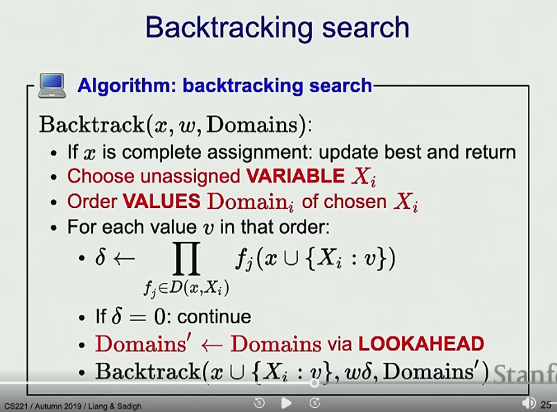

# Factor Graphs 1 - Constraint Satisfaction Problems

Type : video  |  Source : https://www.youtube.com/watch?v=Yo-xat4cn8M&list=PLoROMvodv4rO1NB9TD4iUZ3qghGEGtqNX&index=11

Le : 17/11/2026

## notes

- state models =/= variable-based models
    - on ne cherche pas les différents states mais les différentes variables
    - relation entre les variables : **inférence**
- Factor graphs:
    - possède un set of **variables** (en majuscule: X_1, X_2...)
        - chaque variable vit dans un domain
        - la 'valeur' d'une variable est appelé le **assignment** (minuscule: x_1, x_2 ...)
    - les contraintes entre les variables sont des '**factors**'
        - ce sont des indicator founctions qui renvoient la proba d'une variable en fonction de chaque assignment ($f_j(X)$)
        - elles doivent etre >= 0
    - tout ce qui précède peut etre représenté graphiquement
    - il faut définir f_j pour chaques valeurs de X_i
    - **scope** of a factor : set of variables a factor depends on 
    - **arity**  : number of variables a factor depends on
        - if arity = 1 : unary factor
        - if arity = 2 : binary factor
    - **assignment weights** : each assignment $x$ has a weight  :$W(x) = \Pi f_i(x) $
        - l'objectif est de trouver une solution tel que le weight soit maximal : $arg max W(x)$
- Constraint satisfaction problem (CSP)
    - is a factor graph where all factore are called **constraints** meaning : $f_j(x) \in {0,1}$ 
    - the constaint is satisfied uniquemnet si $f_j(x) = 1$
    - on dit alors qu'on a trouvé un **consistent asssgnment**  si $W(x) = 1$ (meaning all constraints are satisfied)

- How to solve the previous graphs ? -> **Dynamic ordering** ? 
    - **dependent factors** : $D(x,X_i)$ set of factors that depend on X_i and x but not on unassigned variables.
    - Backtracking search :  
        - fonctionne avec plusieurs différentes heuristiques

